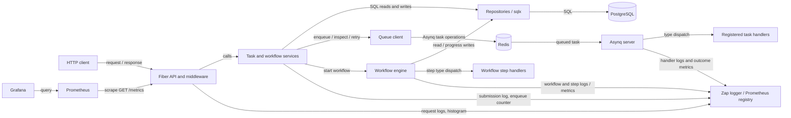
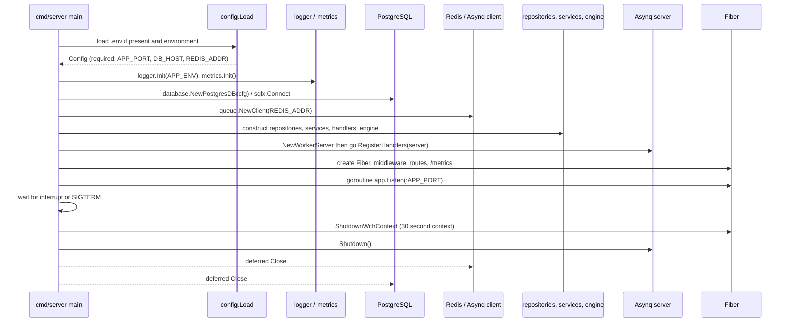
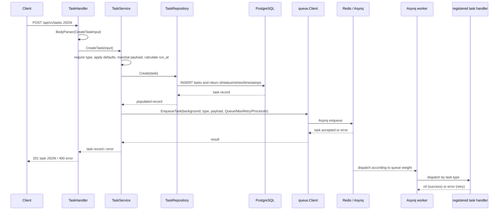
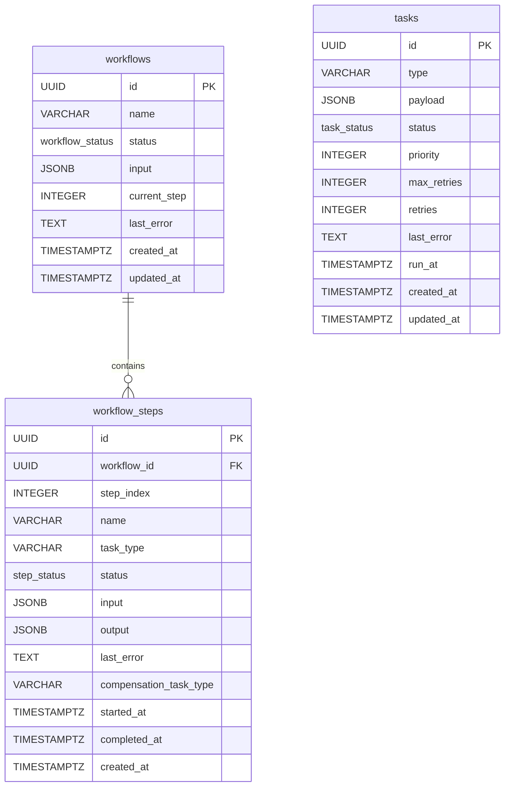
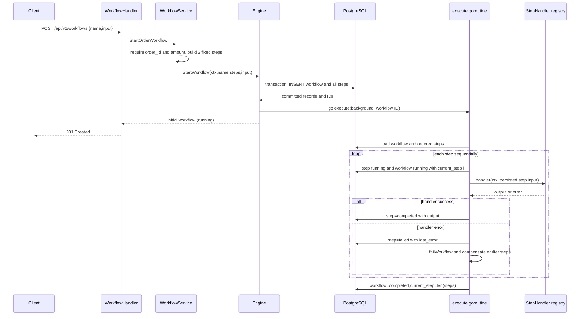
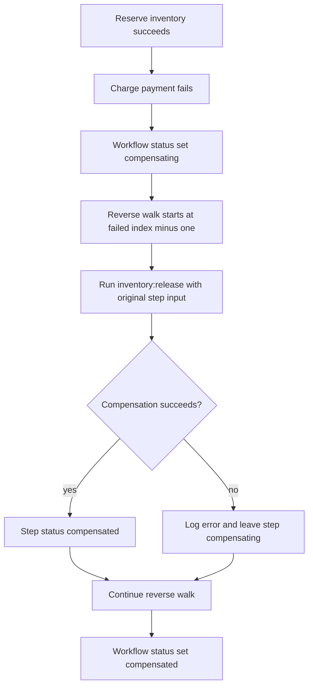
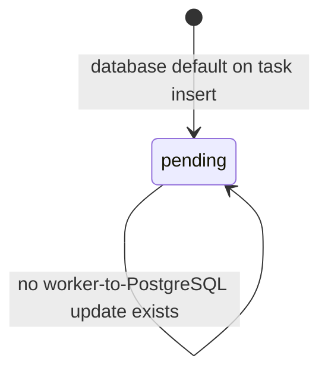
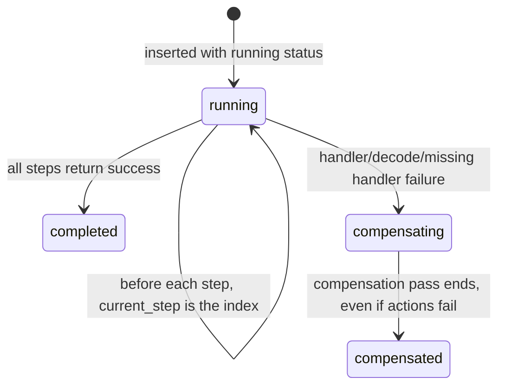
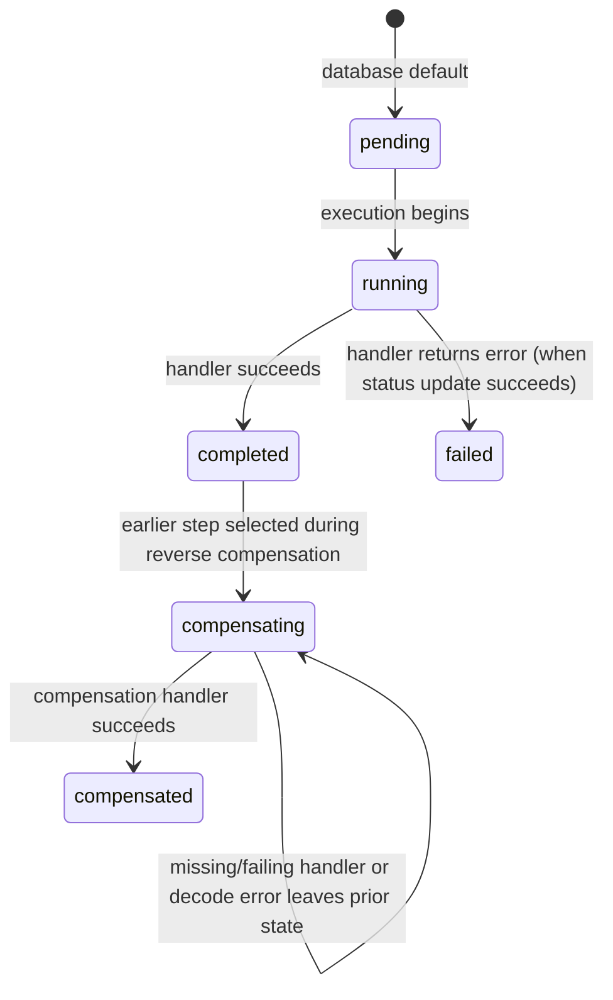

# GoFlow architecture

This guide describes the behavior implemented in this repository. The code, rather than older overview material or Swagger comments, is authoritative where they disagree. GoFlow is a small single-process API, task worker, and in-memory workflow orchestrator backed by PostgreSQL and Redis. It demonstrates common queue and Saga patterns; it does not yet provide a durable distributed workflow runtime.

## Contents

1. [Overview and design goals](#1-overview-and-design-goals)
2. [System architecture at a glance](#2-system-architecture-at-a-glance)
3. [Repository and package map](#3-repository-and-package-map)
4. [Application startup and lifecycle](#4-application-startup-and-lifecycle)
5. [Task lifecycle](#5-task-lifecycle-complete-end-to-end-walkthrough)
6. [Queue architecture](#6-queue-architecture-redis-and-asynq)
7. [Database and persistence](#7-database-and-persistence-architecture)
8. [Workflow engine](#8-workflow-engine-end-to-end-execution)
9. [Saga compensation and recovery](#9-saga-compensation-and-failure-recovery)
10. [API architecture](#10-api-architecture)
11. [State machines and invariants](#11-state-machines-and-invariants)
12. [Observability](#12-observability-logs-and-metrics)
13. [Failure scenarios and consistency](#13-failure-scenarios-and-consistency-analysis)
14. [Concurrency model](#14-concurrency-model)
15. [Deployment, configuration, and build](#15-deployment-configuration-and-build)
16. [Design decisions and alternatives](#16-design-decisions-and-alternatives)
17. [Current limitations and roadmap](#17-current-limitations-and-roadmap)
18. [Glossary and learning path](#18-glossary-and-learning-path)

## 1. Overview and design goals

GoFlow accepts task and workflow requests over HTTP. Individual tasks are saved in PostgreSQL and submitted to Redis through Asynq for background execution. A separate Asynq server in the same Go process consumes registered task types. Workflows are a separate feature: the API stores a workflow and its ordered steps in PostgreSQL, then a goroutine in the API process runs the built-in workflow handlers sequentially and records progress.

Asynchronous tasks let a request return after submission rather than waiting for potentially slow work. The queue can schedule retries and let a worker execute tasks concurrently. Workflows model a fixed sequence of business actions and can invoke compensating actions if a step fails.

The current design favors a compact, understandable deployment: one executable, PostgreSQL for application records, and Redis/Asynq for task dispatch and queue state. The implementation has no API authentication, no workflow queue or restart recovery, no task-status updates from workers into PostgreSQL, and no dynamic workflow-definition API. The example email/report/workflow handlers mostly log or simulate actions; they are not production integrations.

**Task** means one independently queued unit whose type selects an Asynq handler. **Workflow** means a persisted ordered list of step definitions run directly by the workflow engine, not a collection of queued Asynq tasks. **Step handler** means a `workflow.StepHandler` function. **Compensation** means a business action intended to offset an earlier side effect. **Queue state** means Asynq's Redis records; **application state** means the PostgreSQL records exposed by GoFlow.

## 2. System architecture at a glance



The arrows distinguish the synchronous HTTP calls, PostgreSQL persistence, Redis queue operations, and background dispatch. Workflow execution is background work in a goroutine, but it does not pass through Redis or the Asynq worker.

| Component | Responsibility and communication |
|---|---|
| Fiber API (`cmd/server`, `internal/api`) | Parses HTTP input, calls services, serializes responses. Middleware logs and measures requests. It serves `/metrics`, `/health`, and Swagger as well as `/api/v1`. |
| Services (`internal/service`) | Validates task/workflow input, supplies defaults, and coordinates repository and queue/engine calls. |
| Repositories (`internal/repository`) | Execute SQL against PostgreSQL using `sqlx`; they do not communicate with Redis. |
| PostgreSQL | Stores task submissions and workflow/step definitions and progress. Task rows are not synchronized with Asynq execution state. |
| Queue client (`pkg/queue`) | Marshals task payloads, enqueues through Asynq, and uses an Asynq Inspector for archived task listing, retry, and deletion. |
| Redis + Asynq | Redis backs Asynq task queues and archive state. The Asynq server dispatches by task type to worker handlers. |
| Worker (`internal/worker`) | Runs up to ten Asynq task handlers concurrently across the configured weighted queues. |
| Workflow engine (`internal/workflow`) | Persists workflow execution progress and runs a fixed step list in-process, sequentially. It owns the built-in step handler registry and compensation loop. |
| Zap and Prometheus (`pkg/logger`, `pkg/metrics`) | Logs operational events and expose process-local counters, gauges, and histograms. Prometheus scrapes the Fiber endpoint. |

## 3. Repository and package map

```text
cmd/server/main.go             executable, wiring, routes, shutdown
internal/api/                  Fiber handlers and request middleware
internal/service/              task/workflow validation and orchestration
internal/repository/           PostgreSQL records and queries
internal/worker/               Asynq server and task handlers
internal/workflow/             workflow engine and built-in step handlers
pkg/config/                    Viper configuration loading
pkg/database/                  PostgreSQL connection
pkg/queue/                     Asynq client and Inspector wrapper
pkg/logger/                    Zap initialization and convenience methods
pkg/metrics/                   Prometheus metric definitions/registration
migrations/                    SQL schema creation
observability/prometheus.yml   Prometheus scrape target
docs/                          generated Swagger documents and SVG diagram
Dockerfile, docker-compose.yml deployment definitions
Makefile                       development/build/migration commands
```

### Package responsibilities and boundaries

- `cmd/server` is the composition root: `main` loads config, initializes shared dependencies, wires concrete repositories/services/handlers, starts the worker and Fiber server, registers routes, and handles signals. It currently also owns metrics and Swagger HTTP exposure. Business rules do not belong here.
- `internal/api` handles HTTP parsing and response codes. `TaskHandler` delegates to `TaskService`; `WorkflowHandler` delegates to `WorkflowService`. It has no repository or SQL dependency. Middleware uses `pkg/logger` and `pkg/metrics`.
- `internal/service` applies input rules and defaults. `TaskService` calls the task repository and queue client; `WorkflowService` validates the demo input and asks the engine to start the fixed workflow. This is not a generic workflow-definition service.
- `internal/repository` owns SQL models and queries. Task methods are `Create`, `GetAll`, and `GetByID`; workflow methods create a workflow and steps transactionally, fetch details, list workflows, and update status. Queue behavior does not belong here.
- `pkg/queue` wraps Asynq producer and Inspector operations. Its task constants are `email:send`, `report:generate`, and `task:fail`.
- `internal/worker` registers those three task types in `RegisterHandlers`; their concrete handlers are `HandleSendEmail`, `HandleGenerateReport`, and `HandleAlwaysFail`.
- `internal/workflow` is a separate synchronous-in-process handler registry. `Engine` registers `inventory:reserve`, `inventory:release`, `payment:charge`, `payment:refund`, and `notification:send`; its `StepHandler` signature returns output and error. Workflow `TaskType` names are not sent to Asynq.
- `pkg/config`, `database`, `logger`, and `metrics` are infrastructure helpers imported by composition and feature packages. `migrations` is applied externally through `make migrate`; the server does not run migrations.

The actual dependency direction is API → service → repository and queue/engine, with the engine → workflow repository and queue client. `main` wires all concrete dependencies. This is a pragmatic package layout, not a strict interface-driven/hexagonal design: services hold concrete repository/client pointers and dependencies are not injected through interfaces.

## 4. Application startup and lifecycle



`config.Load` uses Viper, reads `.env` if available, and also enables environment lookup. It only explicitly rejects empty `APP_PORT`, `DB_HOST`, and `REDIS_ADDR`; missing DB port/user/password/name are passed into the DSN and fail during connection. `database.NewPostgresDB` builds a `sslmode=disable` DSN and calls `sqlx.Connect`, which opens and pings PostgreSQL. Startup uses `log.Fatal` on a connection error, so deferred cleanup is not run on that fatal path. No migration is invoked at startup.

`metrics.Init` registers collectors with the default Prometheus registry. Fiber mounts `promhttp.Handler()` at `/metrics` through `fasthttpadaptor`; Prometheus configuration scrapes `app:8080`. The `/health` handler returns a constant `200` JSON response and does not check PostgreSQL, Redis, or worker readiness. Swagger is served by `fiber-swagger` at `/swagger/*` from generated package `docs`.

The worker starts by launching `go worker.RegisterHandlers(workerSrv)`. Registration then calls `srv.Run`, which blocks in that goroutine. If it returns an error, the code calls standard-library `log.Fatal` from that goroutine, terminating the process. HTTP `Listen` is also started in a goroutine; an error is logged through `logger.Fatal`. The main goroutine waits only for a signal, so a server startup/listen failure does not have a coordinated error channel.

On SIGINT or SIGTERM, Fiber receives a 30-second shutdown context and then `workerSrv.Shutdown()` is called without that context. Asynq documents `Shutdown` as waiting for active handlers; GoFlow does not call `Stop`, propagate the signal context into task handlers, or set a separate worker shutdown deadline. Database and queue clients close through defers once `main` returns. Workflow goroutines are not tracked or joined and use `context.Background()`, so they are not part of graceful drain.

## 5. Task lifecycle: complete end-to-end walkthrough



1. `TaskHandler.CreateTask` parses JSON into `service.CreateTaskInput`; malformed JSON returns `400 {"error":"invalid request body"}`.
2. `TaskService.CreateTask` requires nonempty `type`, defaults `max_retries` to 3 only when it is zero, and defaults an empty queue to `default`. A negative retry count is not rejected. It marshals `payload` to JSON and records `run_at` as now plus positive `delay_seconds`.
3. `TaskRepository.Create` inserts into `tasks`. The database assigns a UUID and defaults status/retries/timestamps. The returned task includes those fields.
4. The service enqueues only after the SQL insert. `queue.Client.EnqueueTask` marshals the input payload again and uses Asynq options `Queue`, `MaxRetry`; it adds `ProcessIn` for a positive delay. The Asynq context is `context.Background()`, not the HTTP request context. `priority` is persisted but not mapped to an Asynq priority option.
5. On successful enqueue, the service increments `goflow_tasks_enqueued_total{type,queue}` and logs type, queue, and database task ID. It returns the PostgreSQL row and the handler responds `201`.
6. The Asynq worker dispatches by exact type. The handler unmarshals into its payload struct and returns nil or an error. Asynq owns retry and archive state in Redis. The worker handlers do not update the corresponding PostgreSQL task row.

Failures before insert return an error that the handler maps to HTTP 400. Insert failures also become HTTP 400. If insert succeeds but enqueue fails, the API still returns 400, while a pending PostgreSQL row remains without an Asynq task. A successful response means both insert and enqueue returned successfully, but they are two independent operations.

The built-in `email:send` handler unmarshals `{ "to", "subject" }`, logs those values, and returns success; the provider call is a comment. `report:generate` similarly logs `{ "report_type", "user_id" }` and returns success. `task:fail` always returns `intentional failure for testing`. These examples show retry behavior but do not represent integrated email or report processing.

The task handler, service, repository, queue client, worker, and task handler have separate roles: HTTP adaptation; validation/coordination; application-record persistence; queue production/inspection; concurrent consumption/type routing; and side-effect logic, respectively. The final handler's return value tells Asynq success versus failure. It does not update PostgreSQL status or retry counters.

## 6. Queue architecture: Redis and Asynq

The producer is `pkg/queue.Client`, wrapping `asynq.Client`; the consumer is `internal/worker`'s `asynq.Server`. Both use `RedisClientOpt{Addr: REDIS_ADDR}`. Payloads are JSON encoded and stored in an Asynq task with a type string. `ServeMux` maps the task type to a Go function.

`NewWorkerServer` configures queue weights `critical: 6`, `default: 3`, `low: 1` and concurrency 10. Higher weight gives a queue greater scheduling share; this is not a per-task numeric priority. The API can choose a queue name with the request's `queue`, and defaults to `default`. `priority` is not used by the producer or worker. Unknown task type requests are not rejected at submission; they will have no registered handler and Asynq will treat processing as an error/retry.

Positive `delay_seconds` is submitted using `asynq.ProcessIn`. Retry limit is passed as `asynq.MaxRetry`; zero is converted to three first. Retry timing/backoff is provided by Asynq's default behavior because GoFlow does not configure a retry delay or custom backoff. No task timeout, deadline, scheduled cron task, cancellation API, or task context propagation is configured by GoFlow. Asynq supplies a handler context, but the built-in handlers ignore it.

When a task exhausts retries, Asynq archives it in Redis. GoFlow's “dead” endpoints are views and operations on the Asynq archive, not on `tasks` in PostgreSQL. `ListDeadTasks` calls `Inspector.ListArchivedTasks(queue, PageSize(100))`; retry uses `Inspector.RunTask`; delete uses `Inspector.DeleteTask`. The endpoint's empty result behavior is an explicit empty array. `DeadTasks` metric is defined but never updated. There is no pagination parameter beyond the fixed 100 items.

PostgreSQL and Redis are separate persistence systems. GoFlow does not implement an outbox or distributed transaction, so there is no atomic commit spanning task row and queue enqueue. Task handler side effects can be repeated if processing is retried or delivery is repeated around failure; handlers should be idempotent (safe to repeat) when side effects matter. The exact recovery/delivery behavior under Redis failure or process loss depends on Asynq and Redis configuration, including persistence settings; Compose configures a Redis container but no explicit data volume or persistence policy.

## 7. Database and persistence architecture

The schema is created by `migrations/001_create_tasks.sql` and `002_create_workflows.sql`. The application opens PostgreSQL through `sqlx` and `lib/pq`. There is no migration tracking/version table and no startup migration runner; `make migrate` pipes each SQL file into `psql` every time, so the `CREATE TYPE` statements are not idempotent even though tables/indexes use `IF NOT EXISTS`.



`tasks` stores the submitted type and JSONB payload, status/retry-shaped fields, scheduling time, and timestamps. Indexes exist on status and run_at. In the present code only `Create` and read methods use this table; no code changes task status, retries, or last error after creation. Therefore its status usually remains `pending` even after Asynq succeeds, retries, or archives the corresponding Redis task.

`workflows` stores the workflow input and aggregate state. `workflow_steps` stores the ordered definitions and per-step input/output/error/timing. `workflow_steps.workflow_id` references `workflows.id` with `ON DELETE CASCADE`; indexes cover `workflow_steps.workflow_id` and `workflows.status`. There is no unique constraint on `(workflow_id, step_index)`. The `tasks` table is independent from both workflow tables.

The workflow create operation is atomic within PostgreSQL: `WorkflowRepository.Create` begins a transaction, inserts workflow and all steps, then commits. Updates to workflow and step status are separate SQL statements, not a transaction with handler side effects or with each other. Task creation is one autocommit INSERT followed by a separate Redis enqueue. Reads use `SELECT *`; updates use explicit fields and set `updated_at` for workflow only. `UpdateStepStatus` uses an explicit `::step_status` cast.

JSONB makes arbitrary input easy to persist and query, but the Go structs expose it as raw bytes and there is no schema/version validation beyond handler unmarshalling. `output` may be SQL NULL; the code writes marshaled output on successful steps. The engine ignores JSON marshal errors for step input/output after initial workflow input marshal succeeds.

**Authority boundary:** PostgreSQL is authoritative for GoFlow's task submission record and workflow/step record. Redis/Asynq is authoritative for whether a queued task is waiting, active, retrying, or archived. There is no reconciliation between them, so API `GET /tasks/:id` is not a reliable execution-status view.

## 8. Workflow engine: end-to-end execution

`POST /api/v1/workflows` parses `{name,input}`. The handler defaults empty name to `order:process`. `WorkflowService.StartOrderWorkflow` requires `input.order_id` and `input.amount`; it always creates the same three step definitions regardless of name. Their input maps are all the original workflow input. The engine JSON-encodes the workflow input, transactionally inserts the workflow and steps with initial status `running`, then starts `go e.execute(context.Background(), wf.ID)`. The handler returns `201` with the initial workflow record while execution continues.



The demo definition in `WorkflowService` is:

| Index | Step | Handler type | Compensation |
|---:|---|---|---|
| 0 | Reserve Inventory | `inventory:reserve` | `inventory:release` |
| 1 | Charge Payment | `payment:charge` | `payment:refund` |
| 2 | Send Confirmation | `notification:send` | none |

The engine loads steps ordered by `step_index`; before each call it attempts to mark the step running and workflow running with `current_step=i`. It looks up the handler by `TaskType`, unmarshals that persisted step's input, and calls it. Successful output is JSON-encoded and stored on the step, but is not passed into later steps. Each step gets the same original input. A handler error marks that step `failed` before compensation. A missing handler or input decode failure enters compensation without changing the step from `running`. Repository update errors are logged and execution generally continues, so recorded state can lag actual work.

The engine is sequential within a workflow; separate requests spawn separate goroutines and can run concurrently. The engine does not use Redis or the `Engine.client` field in execution. The persisted workflow and step rows survive a process restart, but the goroutine and its current call stack do not. There is no startup scanner, resume logic, lease, or workflow lock. A workflow left `running` or `compensating` is not resumed automatically.

## 9. Saga compensation and failure recovery

A Saga is a sequence of independently committed business operations with compensating operations to reduce the impact of a later failure. Compensation is not a PostgreSQL rollback: an email, payment, or inventory action that already happened cannot be undone by rolling back the row that described it. A compensation can itself fail and may need later operator action.

On a step failure at index `i`, `failWorkflow` sets workflow state to `compensating`, then iterates from `i-1` down to `0`. Thus it considers only earlier steps, not the failing step. It skips steps without a compensation type. For each configured compensation, it finds the named handler in the same registry, marks that earlier step `compensating`, unmarshals that step's original input, and calls the handler with `context.Background()`. A missing handler or decode error is logged and skipped. A handler error is logged and execution continues; the engine does not persist that compensation error to the step. A successful compensation changes that step to `compensated`.



For the built-in `order:process`, amount greater than 1000 makes `payment:charge` fail. `inventory:reserve` has already succeeded, so `inventory:release` is invoked. `payment:refund` does not run because the failing payment step is excluded from the reverse loop. The confirmation step never starts. Although step definitions attach `payment:refund` to the payment step, compensation is selected only for indices before `failedAt`.

There is a misleading terminal state: after any compensation loop, even one with missing/failed compensation handlers, workflow state is set to `compensated` and the `compensated` metric increments. A failed compensation remains at `compensating`; the workflow does not become `failed`, and its `last_error` remains the original step error. This means `compensated` means the compensation pass ended, not that every business action was reversed. There are no compensation retries, resume endpoint, reconciler, or durable compensation queue. A crash can leave workflow and step states partway through; restart recovery is absent.

## 10. API architecture

All routes are registered in `cmd/server/main.go`. There is no authentication or authorization middleware. `LoggerMiddleware` is the only application middleware. JSON response shapes below follow handlers; Swagger may be stale or incomplete.

| Method and route | Purpose / shape | Handler behavior and dependencies |
|---|---|---|
| `POST /api/v1/tasks` | Create task from `type`, `payload`, `priority`, `max_retries`, `delay_seconds`, `queue`; returns task row. | `TaskHandler.CreateTask` → `TaskService.CreateTask`; `201`, malformed/validation/repository/enqueue errors `400`. |
| `GET /api/v1/tasks` | Returns `{tasks,count}` for all task rows newest first. | Service/repository; database error `500` with generic message. No pagination. |
| `GET /api/v1/tasks/:id` | Returns one PostgreSQL task row. | Missing/DB error mapped to `404` with error text. Does not inspect Asynq state. |
| `GET /api/v1/tasks/dead?queue=default` | Returns `{queue,count,tasks}` from archived Asynq tasks (maximum 100). | Query defaults to `default`; Inspector failure `500`. Route registered before `:id`. |
| `POST /api/v1/tasks/dead/:id/retry?queue=default` | Requeues archived task with same Asynq ID via `Inspector.RunTask`; returns `{message,id}`. | Defaults queue; errors `400`; does not change PostgreSQL row. |
| `DELETE /api/v1/tasks/dead/:id?queue=default` | Deletes archived Asynq task; returns `{message,id}`. | Defaults queue; errors `400`; does not delete PostgreSQL record. |
| `POST /api/v1/workflows` | `{name,input}`; returns the initially created workflow row. Empty name defaults to `order:process`. | Requires `input.order_id` and `input.amount`; fixed three-step workflow; creation/validation errors `400`. |
| `GET /api/v1/workflows` | Returns `{count,workflows}` newest first. | PostgreSQL error `500`; no pagination. |
| `GET /api/v1/workflows/:id` | Returns `{workflow,steps}` ordered by step index. | Database/missing workflow error `404`. |
| `GET /health` | Returns `{"status":"ok","service":"goflow"}`. | Constant response; no dependency health checks. |
| `GET /metrics` | Prometheus exposition format. | Default Go registry via `promhttp` adapter. |
| `GET /swagger/*` | Swagger UI and generated specification. | `fiber-swagger` and `docs` package. |

The task API exposes `payload` as a Go `[]byte` field in the repository model, which `encoding/json` represents as a base64 string. Endpoint definitions are not uniformly documented in generated Swagger: dead-task operations are not described there.

## 11. State machines and invariants

The database enums define the status vocabulary, but GoFlow does not centrally validate legal transitions. The following diagrams show transitions actually performed by application code; `pending`, `failed`, and `dead` task statuses are not assigned by worker code.



Asynq has a separate task lifecycle in Redis (queued/active/retrying/archived and other library-managed states). GoFlow does not mirror that lifecycle into the task enum.





Important details and consistency edges:

- Task state is only initialized on insert. `retries`, `last_error`, and task terminal statuses do not reflect Asynq outcomes.
- Workflow starts as `running` at creation; `pending` is not used by the engine. `current_step` is zero-based while executing and is set to number of steps on successful completion; on failure it is set to the failing index and remains there after compensation.
- The failing workflow step becomes `failed`; only previous steps with compensation configured are considered. Later steps remain `pending`; skipped status is not assigned.
- The engine logs, but does not stop on, most status-update errors. Thus handler outcome and persisted state can diverge.
- Repository updates have no compare-and-set or workflow lock. Duplicate `execute` calls (not currently scheduled automatically) could race.
- `UpdateStepStatus` sets `completed_at` for `completed`, `failed`, `compensated`, and also `compensating`; `started_at` is set whenever status becomes `running`. These timestamps are not a clean “finished only” invariant.

## 12. Observability: logs and metrics

Zap is initialized once in `main`. `APP_ENV=production` uses Zap's production configuration (JSON encoder); other values use its development configuration with colored levels. Logging calls carry fields such as task type, queue, task/workflow/step IDs, names, errors, durations, and request method/path/status/IP. The HTTP middleware logs every request after `c.Next()` and observes a duration histogram. Worker task handler logs do not consistently include task ID; the built-in task handler metrics are emitted only by handlers themselves.

| Metric | Type and labels | Emission point / interpretation |
|---|---|---|
| `goflow_tasks_enqueued_total` | Counter `{type,queue}` | Incremented after task record insert and successful Asynq enqueue. Does not count failed enqueue attempts. |
| `goflow_tasks_processed_total` | Counter `{type,status}` | Email/report handlers increment `success`; always-fail handler increments `failure` each attempt. Other errors (including malformed payload in email/report) return before increment. It counts handler invocations at those code points, not unique tasks or final outcomes. |
| `goflow_task_duration_seconds` | Histogram `{type}` | Observed on successful email/report handlers only; no observation in failing handler. |
| `goflow_dead_tasks_total` | Gauge `{queue}` | Registered but no code updates it, so it provides no useful archive count. |
| `goflow_workflows_started_total` | Counter `{name}` | Incremented after workflow/steps load inside the execution goroutine, not at API acceptance. A load failure is not counted. |
| `goflow_workflows_completed_total` | Counter `{name,status}` | Incremented for successful completion and after the compensation pass (`completed` or `compensated`). Compensation failures still count as compensated. No `failed` increment is emitted. |
| `goflow_workflow_duration_seconds` | Histogram `{name}` | Observed only on successful workflow completion; failure path does not observe it. |
| `goflow_http_request_duration_seconds` | Histogram `{method,route,status_code}` | Middleware observes each request after route handling. Uses Fiber's matched route path and response status. |

Prometheus uses a static target `app:8080` and a 5-second scrape interval in Compose. Grafana is included as a query UI and depends on Prometheus, but no dashboard provisioning or alert rules are present. Route, task type, queue, workflow name, and status labels are bounded only by user/request choices in some cases; arbitrary task types, queue names, and workflow names can increase label cardinality. Current metrics cannot reliably show PostgreSQL task completion, current archived-task count, compensation success rate, per-step latency, queue depth, retry count, or workflow goroutines stuck after restart.

## 13. Failure scenarios and consistency analysis

| Scenario | Expected behavior in current implementation | Data/state affected | Limitations or recovery |
|---|---|---|---|
| PostgreSQL unavailable during startup | `sqlx.Connect` fails; `log.Fatal` exits process. | No service starts; no migrations run. | Compose waits for health check, but outside Compose there is no retry loop. Fatal exit bypasses deferred cleanup. |
| Redis unavailable during task submission | SQL insert occurs first; Asynq enqueue returns an error and API returns 400. | A `pending` task row can remain with no queue entry. | No outbox/reconciler; caller retry may create another row/task. |
| PostgreSQL insert succeeds, enqueue fails | Same as above: service returns error after row creation. | Orphaned PostgreSQL task record. | No API to enqueue an existing task row. |
| Task fails temporarily | Handler error is returned to Asynq; Asynq schedules retry with its defaults up to configured retry count. | Redis state changes; PostgreSQL task row remains as inserted. | `task:fail` increments failure metric on each attempt; no PostgreSQL retry/error update. |
| Task exhausts retries | Asynq archives it; dead endpoint can list/run/delete it. | Archive in Redis; task row still usually `pending`. | Fixed page size 100; dead gauge is not updated. Redis persistence depends on deployment settings. |
| Worker process exits while processing | Asynq/Redis behavior governs recovery of in-progress task. | Queue state may be requeued/recovered according to Asynq and Redis behavior; task row is unchanged. | GoFlow has no explicit recovery policy or integration test documenting this case. Exact result depends on library and Redis conditions. |
| Duplicate executions cause duplicate side effects | Handler may execute again on retry or delivery recovery. | External effect can be duplicated; task row does not record deduplication. | No idempotency key or deduplication logic supplied by GoFlow; handler author must address it. |
| Workflow step fails | Step is marked failed when possible; prior compensatable steps are processed in reverse; workflow ultimately marked compensated. | Step/workflow rows; prior side effects may be compensated. | Failing step itself is not compensated; later steps remain pending. Status updates may fail while execution continues. |
| Compensation handler fails or is missing | Error/missing registry entry is logged; loop continues; workflow still becomes compensated. | Step can remain `compensating`; workflow last_error is original failure. | No retry, failed terminal state, or operator recovery endpoint; terminal label is misleading. |
| Process crashes during workflow | Persisted records remain, but goroutine stops. | Workflow may remain running/compensating and a step running/compensating. | No restart scan, resume, lease, or reconciliation. |
| Shutdown during task execution | HTTP drain runs first; `workerSrv.Shutdown()` waits for running tasks. | Running task behavior depends on handler finishing and Asynq shutdown. | 30s context is only passed to Fiber; worker shutdown has no explicit deadline, and handler contexts are not canceled from signal. |
| Shutdown during workflow | No explicit workflow shutdown coordination. | Workflow may finish if goroutine remains alive until process exits; otherwise state may be mid-flight. | No wait group or cancellation; no guaranteed drain. |
| Metrics/notification operation fails | Prometheus registry is in-process; scrape failure is external. There is no notification integration. | Metrics may be absent/reset on process restart; no notification state exists. | Metrics are not persisted; scrape errors do not affect task/workflow logic. |

The behavior of Asynq during worker interruption and Redis failure is delegated to the library and Redis deployment. GoFlow's code does not configure Redis persistence, a custom recovery strategy, or a task lease policy, so stronger delivery guarantees cannot be inferred here.

## 14. Concurrency model

Fiber handles multiple HTTP requests concurrently according to its server model. Task API calls can overlap SQL inserts and queue enqueues. Asynq's worker has concurrency 10, so up to ten handlers can run at once in this process; multiple replicas would each add their own configured worker concurrency, though Compose currently runs one app container.

Each workflow execution uses one goroutine and iterates steps sequentially. Separate workflow requests can therefore run concurrently with one another and with task handlers. There is no global workflow limit, semaphore, or persisted claim/lock. DB connection pool settings are not customized in `database.NewPostgresDB`, so `database/sql` defaults apply.

Individual SQL statements are atomic in PostgreSQL; workflow and step creation share a transaction. Task row insert and Redis enqueue do not share a transaction. Workflow business handler calls and status updates are not transactional. The handlers receive a context, but workflow execution passes `context.Background()` and compensation also passes a new background context; task handlers receive Asynq context but current examples do not use cancellation. Request cancellation does not cancel task enqueue or workflow execution.

Potential pressure points are unbounded workflow goroutine creation, list-all SQL/API endpoints without pagination, ten concurrent task handlers regardless of task resource needs, and Redis/PostgreSQL as shared dependencies. No benchmarks or capacity targets are included.

## 15. Deployment, configuration, and build

Compose defines five services:

| Service | Image/build | Port | Role and persistence |
|---|---|---:|---|
| `postgres` | `postgres:16-alpine` | 5432 | Application database; named `postgres_data` volume; `pg_isready` health check. |
| `redis` | `redis:7-alpine` | 6379 | Asynq backend; ping health check; no named data volume configured. |
| `app` | built from `Dockerfile` | 8080 | API + worker + workflow engine in one process; starts after healthy PostgreSQL and Redis. Restart policy `unless-stopped`. |
| `prometheus` | `prom/prometheus:latest` | 9090 | Scrapes `app:8080` every five seconds; mounts `observability/prometheus.yml`. |
| `grafana` | `grafana/grafana:latest` | 3000 | Visualization UI; named `grafana_data`; depends on Prometheus. |

`pkg/config.Load` reads `.env` from the process working directory if present, then looks up environment variables. Recognized keys are `APP_PORT`, `APP_ENV`, `DB_HOST`, `DB_PORT`, `DB_USER`, `DB_PASSWORD`, `DB_NAME`, and `REDIS_ADDR`. Only `APP_PORT`, `DB_HOST`, and `REDIS_ADDR` are explicitly validated as nonempty; all DB fields are needed for a usable connection. Use placeholders in local examples and keep actual credentials out of documentation. Compose currently embeds development-style database credentials and Grafana's default admin password directly in its environment; deployments should override these values.

`make run` uses `go run ./cmd/server/main.go`; `make build` sets `CGO_ENABLED=0`, `GOOS=linux`, and `GOARCH=amd64`, strips symbols with `-ldflags="-s -w"`, and writes `bin/goflow`. The Dockerfile uses `golang:1.25-alpine` to build and `alpine:3.19` to run, installs CA certificates and timezone data in both stages, and runs as a non-root `goflow` user. `CGO_ENABLED=0` removes the cgo runtime dependency, but the document makes no claim about exact image size. The executable is built for amd64 only.

`make migrate` applies each SQL file using `docker exec ... psql`; the server itself does not migrate. Compose `depends_on` health conditions coordinate app startup with the two infrastructure checks. Prometheus and Grafana do not gate app startup. The Prometheus mount uses `:z`, which is a container volume relabel option useful on SELinux hosts. Compose publishes infrastructure ports to the host; it is a development topology, not a hardened deployment specification.

## 16. Design decisions and alternatives

| Decision | Why it was chosen | Benefits | Costs and limitations | Alternative |
|---|---|---|---|---|
| Go + Fiber | Go executable and Fiber provide the HTTP server and worker in one runtime. | Simple deployment, static build option, familiar Go concurrency. | Fiber/fasthttp APIs differ from `net/http`; one process couples API and worker scaling. | `net/http` or separate API and worker services when ecosystem compatibility or scaling isolation matters. |
| PostgreSQL for application records | Relational storage for task/workflow records and transactional workflow creation. | Durable structured state, JSONB flexibility, SQL visibility. | Task runtime state is not synchronized; requires external migration command. | A dedicated workflow store or event log where execution history/replay is central. |
| Redis + Asynq for task dispatch | Existing producer, worker, retry, queue, and archive abstractions. | Avoids implementing queue scheduling and retry machinery in GoFlow. | Separate consistency domain; operational Redis dependency; library owns delivery state. | PostgreSQL-backed queue/outbox for atomic enqueue intent, or another broker where routing/stream semantics fit better. |
| API/service/repository packages | Keeps HTTP mapping, coordination, and SQL queries in separate packages. | Clear starting points for contributors. | Concrete dependencies and limited interfaces make substitution/testing harder. | Interfaces at boundaries when multiple implementations or isolated tests are needed. |
| Workflow goroutine per request | Small direct implementation for the fixed demo flow; response can return promptly. | Easy to follow, steps execute in order. | Process-bound, unbounded concurrency, no crash resumption or independent scaling. | Persisted workflow queue/state machine or dedicated durable workflow platform. |
| Saga-style compensation | Allows the example to attempt business corrections after failure. | Models cross-system corrective actions without pretending to roll back side effects. | Best-effort errors are swallowed into `compensated`; no retry/reconciliation. | Durable compensation commands, operator queue, or a workflow platform with retryable activities. |
| JSONB task/workflow inputs | Supports flexible request payloads without a table per type. | Easy to store and pass structured input. | Shape errors surface at handler decode; no versioning/schema validation; raw bytes API output. | Typed versioned payload schemas or normalized columns for stable/query-heavy fields. |
| Zap and Prometheus | Structured event logs and standard scrape metrics. | Works with common log/metrics tooling. | Incomplete outcome instrumentation, metrics reset on restart, some labels are caller-controlled. | Add tracing, bounded label policy, durable audit events and alert/dashboard configuration as operational needs grow. |
| Multi-stage Docker build | Separates Go build toolchain from runtime image. | Smaller runtime contents; non-root process; cgo disabled. | Still based on Alpine and amd64-only build; no exact size guarantee. | Distroless/minimal base or multi-architecture build where operational requirements justify it. |

## 17. Current limitations and roadmap

### Implemented and verified

- HTTP task submission/list/detail and archived-task list/retry/delete operations.
- Asynq task type routing, three built-in handlers, weighted queues, concurrency 10, delayed enqueue, and configured retry count.
- PostgreSQL task submission records and transactional creation of workflow plus step rows.
- Fixed `order:process` workflow definition, sequential handlers, output persistence, and best-effort reverse compensation.
- `/health`, `/metrics`, Swagger, Zap logging, Prometheus scrape configuration, and Compose topology.

### Partially implemented or limited

- Task status/retry schema exists, but processing never updates it; Asynq state is separate.
- `priority` is stored but ignored; queues are selected by name and static weights.
- Workflow step outputs are saved but are not inputs to subsequent steps.
- Compensation status is optimistic: failed/missing compensation still leads to workflow `compensated`.
- Workflow definitions and handler mappings are hardcoded; request `name` does not select a different definition.
- Some metrics are defined but unused or only updated on a subset of outcomes.
- Health endpoint reports process-level constant status rather than dependency readiness.
- List endpoints are unpaginated; dead task listing is capped at 100 without a cursor.

### Improvements mentioned in existing architecture notes, not implemented

The prior architecture text listed crash recovery from `current_step`, step output chaining, parallel execution, conditional branching, PostgreSQL task-status synchronization, API JWT authentication, client rate limiting, a separate worker executable, and GitHub Actions CI. Repository code/configuration does not implement these. Treat them as suggested work, not a committed roadmap.

At a high level, crash recovery requires durable execution ownership and safe replay rules, not only reading `current_step`; output chaining and branches require a persisted input/output contract; parallel steps need dependency and join state; status synchronization needs a reliable link between PostgreSQL task IDs and Asynq tasks plus update/reconciliation logic; authentication/rate limiting belong at the HTTP boundary; independent scaling requires a worker-only executable and deployment topology; CI requires a repository workflow and pinned checks. The current architecture notes are the only evidence that these were proposed.

## 18. Glossary and learning path

- **Task queue:** a system that holds units of work until consumers can process them.
- **Message broker:** software that routes/stores messages between producers and consumers; Redis plus Asynq provides this role for queued tasks here.
- **Producer / consumer:** code that enqueues tasks / code that receives and handles them.
- **Worker:** the long-running consumer process; GoFlow's worker runs inside the API executable.
- **Retry / backoff:** another processing attempt after an error, delayed according to a policy. Asynq supplies the default retry timing; GoFlow sets the maximum count.
- **Dead-letter queue:** a place for exhausted messages. Here the API's dead operations inspect Asynq's archived tasks in Redis.
- **Idempotency:** making repeated execution produce a safe equivalent result; important because retries or recovery can repeat side effects.
- **Workflow:** a sequence of steps with persisted progress, executed by GoFlow's in-process engine.
- **Saga / compensation:** a multi-operation business process / a corrective action intended to offset an earlier operation.
- **Transaction boundary:** the set of database operations committed atomically. It does not include external effects or Redis in GoFlow's task submission path.
- **JSONB:** PostgreSQL's binary JSON type, used for flexible payload/input/output storage.
- **Prometheus counter:** monotonically increasing event total; **gauge:** a value that may rise or fall; **histogram:** observations grouped into buckets, commonly used for durations.

### Suggested source reading order

1. [`cmd/server/main.go`](cmd/server/main.go): startup, wiring, routes, shutdown.
2. [`internal/api/task.go`](internal/api/task.go) and [`internal/service/task.go`](internal/service/task.go): task request and service path.
3. [`internal/repository/task.go`](internal/repository/task.go), [`migrations/001_create_tasks.sql`](migrations/001_create_tasks.sql), and [`pkg/queue/client.go`](pkg/queue/client.go): persistence and queue submission.
4. [`internal/worker/server.go`](internal/worker/server.go) and [`internal/worker/handlers.go`](internal/worker/handlers.go): worker setup, type routing, and outcomes.
5. [`internal/api/workflow.go`](internal/api/workflow.go), [`internal/service/workflow.go`](internal/service/workflow.go), and [`internal/workflow/engine.go`](internal/workflow/engine.go): workflow creation, execution, and compensation.
6. [`internal/workflow/handlers.go`](internal/workflow/handlers.go), [`internal/repository/workflow.go`](internal/repository/workflow.go), and [`migrations/002_create_workflows.sql`](migrations/002_create_workflows.sql): built-in example steps and persisted state.
7. [`pkg/config/config.go`](pkg/config/config.go), [`pkg/metrics/metrics.go`](pkg/metrics/metrics.go), [`internal/api/middleware.go`](internal/api/middleware.go), [`docker-compose.yml`](docker-compose.yml), and [`Dockerfile`](Dockerfile): configuration, instrumentation, and deployment.
