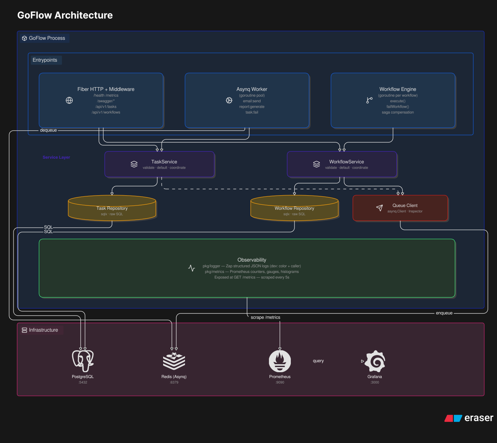

# GoFlow

GoFlow is a distributed task queue and workflow engine written in Go.

It gives you:

- an HTTP API for creating tasks and workflows
- a Redis-backed async worker for background processing
- PostgreSQL persistence for task and workflow state
- Saga-style compensation for multi-step workflows
- Prometheus metrics, structured logs, and Swagger docs

The default setup runs the API server, workflow engine, and worker in one Go process, while PostgreSQL and Redis run as external services.



---

## Requirements

- Go 1.21+
- Docker and Docker Compose

---

## Quick Start

```bash
git clone https://github.com/yourusername/goflow.git
cd goflow
docker compose up -d --build
make migrate
```

Then verify the app is up:

```bash
curl http://localhost:8080/health
```

Useful URLs:

| Service | URL |
|---|---|
| GoFlow API | http://localhost:8080 |
| Swagger UI | http://localhost:8080/swagger/index.html |
| Prometheus | http://localhost:9090 |
| Grafana | http://localhost:3000 |

Grafana login: `admin` / `admin`

---

## Local Development

```bash
# Start infrastructure only: PostgreSQL, Redis, Prometheus, Grafana
make docker/up

# Run migrations
make migrate

# Start the Go service locally
make run
```

The `make run` target uses `go run ./cmd/server/main.go`, so the app reads config from your environment or a local `.env` file.

---

## Environment Variables

Create a `.env` file for local development:

```env
APP_PORT=8080
APP_ENV=development

DB_HOST=localhost
DB_PORT=5432
DB_USER=goflow
DB_PASSWORD=goflow_secret
DB_NAME=goflow_db

REDIS_ADDR=localhost:6379
```

Notes:

- `APP_PORT`, `DB_HOST`, and `REDIS_ADDR` are required for startup.
- The database connection also needs `DB_PORT`, `DB_USER`, `DB_PASSWORD`, and `DB_NAME`.
- In Docker, these values are injected by `docker-compose.yml`, so a `.env` file is optional.

---

## What It Does

### Tasks

Tasks are created over HTTP, persisted in PostgreSQL, and queued in Redis for async processing.

Endpoints:

| Method | Endpoint | Description |
|---|---|---|
| `POST` | `/api/v1/tasks` | Enqueue a task |
| `GET` | `/api/v1/tasks` | List all tasks |
| `GET` | `/api/v1/tasks/:id` | Get a task by ID |
| `GET` | `/api/v1/tasks/dead?queue=default` | List dead tasks |
| `POST` | `/api/v1/tasks/dead/:id/retry` | Retry a dead task |
| `DELETE` | `/api/v1/tasks/dead/:id` | Delete a dead task |

Example:

```bash
curl -X POST http://localhost:8080/api/v1/tasks \
  -H 'Content-Type: application/json' \
  -d '{
    "type": "email:send",
    "payload": {
      "to": "user@example.com",
      "subject": "Hello"
    },
    "priority": 1,
    "max_retries": 3,
    "queue": "default",
    "delay_seconds": 0
  }'
```

Built-in task types:

- `email:send`
- `report:generate`
- `task:fail`

Queues:

- `critical` with weight `6`
- `default` with weight `3`
- `low` with weight `1`

### Workflows

Workflows are stateful multi-step processes. GoFlow includes a demo workflow called `order:process`.

Endpoints:

| Method | Endpoint | Description |
|---|---|---|
| `POST` | `/api/v1/workflows` | Start a workflow |
| `GET` | `/api/v1/workflows` | List all workflows |
| `GET` | `/api/v1/workflows/:id` | Get workflow + step details |

Example:

```bash
curl -X POST http://localhost:8080/api/v1/workflows \
  -H 'Content-Type: application/json' \
  -d '{
    "name": "order:process",
    "input": {
      "order_id": "order_001",
      "amount": 99.99
    }
  }'
```

To test compensation, set `amount` greater than `1000` and the payment step will fail.

Workflow statuses:

- `pending`
- `running`
- `completed`
- `failed`
- `compensating`
- `compensated`

Step statuses:

- `pending`
- `running`
- `completed`
- `failed`
- `compensating`
- `compensated`
- `skipped`

Built-in workflow: `order:process`

```text
Step 1: inventory:reserve  -> on failure: inventory:release
Step 2: payment:charge     -> on failure: payment:refund
Step 3: notification:send  -> no compensation
```

If step 2 fails, compensation runs in reverse order: `payment:refund` -> `inventory:release`.

---

## Observability

GoFlow exposes:

- `GET /metrics` for Prometheus
- structured JSON logs through Zap
- Swagger docs at `/swagger/index.html`

Key metrics include task throughput, task duration, workflow status counts, workflow duration, and HTTP request latency.

Prometheus scrapes the app every 5 seconds in the default Docker setup.

Grafana is available at http://localhost:3000.

Suggested queries:

```promql
# Workflow outcomes
goflow_workflows_completed_total

# HTTP p95 latency
histogram_quantile(0.95, rate(goflow_http_request_duration_seconds_bucket[1m]))

# Task failure rate
rate(goflow_tasks_processed_total{status="failure"}[5m])
```

---

## Docker

The image uses a multi-stage build:

1. Builder: `golang:1.25-alpine`
2. Runtime: `alpine:3.19`

```bash
docker build -t goflow:latest .
docker compose up -d --build
docker compose down
docker compose down -v
```

Container startup order:

1. PostgreSQL
2. Redis
3. App
4. Prometheus
5. Grafana

---

## Project Structure

```text
goflow/
├── cmd/server/main.go          # Entry point
├── docs/                       # Swagger-generated docs
├── internal/
│   ├── api/                    # HTTP handlers + middleware
│   ├── service/                # Business logic
│   ├── repository/             # SQL access layer
│   ├── worker/                 # Asynq worker handlers
│   └── workflow/               # Workflow engine and step handlers
├── pkg/
│   ├── config/                 # Configuration loading
│   ├── database/               # PostgreSQL setup
│   ├── queue/                  # Redis/Asynq client
│   ├── logger/                 # Zap logger setup
│   └── metrics/                # Prometheus metrics
├── migrations/                 # SQL migrations
├── observability/              # Prometheus config
├── Dockerfile
├── docker-compose.yml
├── Makefile
└── go.mod
```

---

## Troubleshooting

- If the app exits immediately, check that `APP_PORT`, `DB_HOST`, and `REDIS_ADDR` are set.
- If migrations fail, make sure PostgreSQL is running first.
- If tasks are not being processed, confirm Redis is reachable and the worker is running.
- If Swagger is blank or stale, regenerate the docs before rebuilding the app.
- If a workflow fails unexpectedly, inspect `/api/v1/workflows/:id` for the workflow and step states.

---

## Make Commands

```bash
make help           # list all commands
make run            # run server locally
make build          # compile static binary -> bin/goflow
make migrate        # run all SQL migrations
make migrate/reset  # wipe and re-run migrations
make db/connect     # open psql session
make docker/up      # start infrastructure containers
make docker/down    # stop all containers
make docker/build   # build Docker image
make docker/logs    # tail all container logs
make lint           # run golangci-lint
make test           # run all tests
make vet            # run go vet
make tidy           # tidy go modules
make setup          # install dev tools
```
